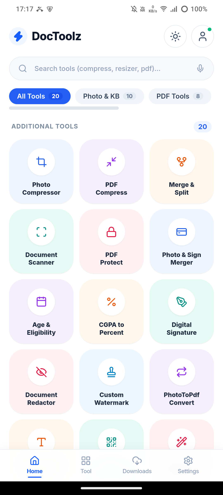
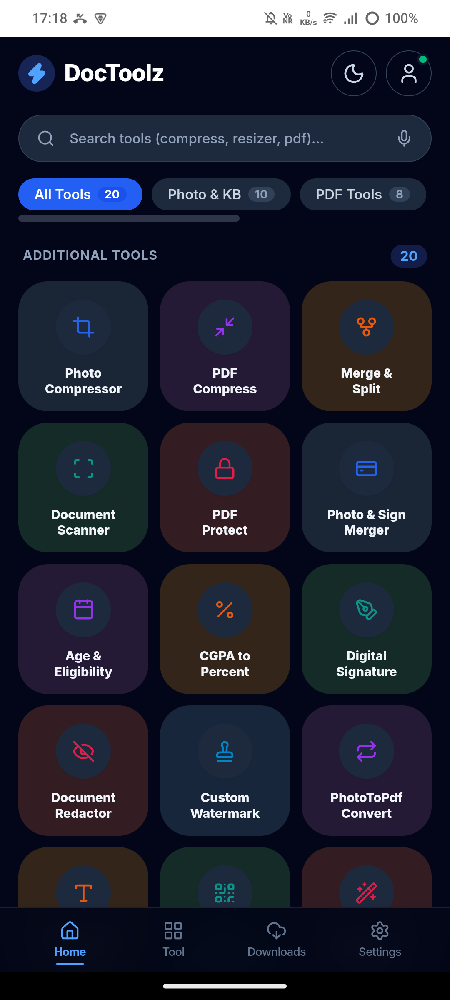
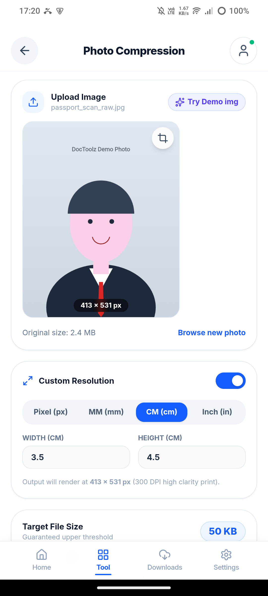
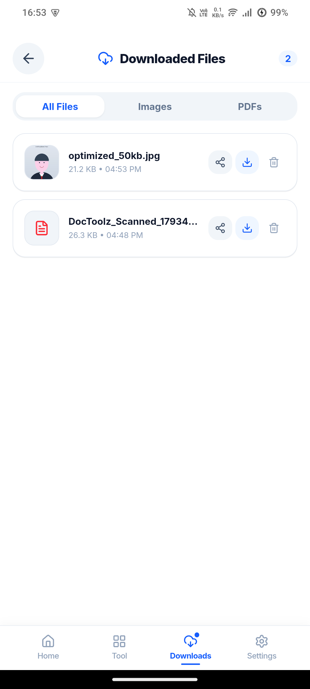
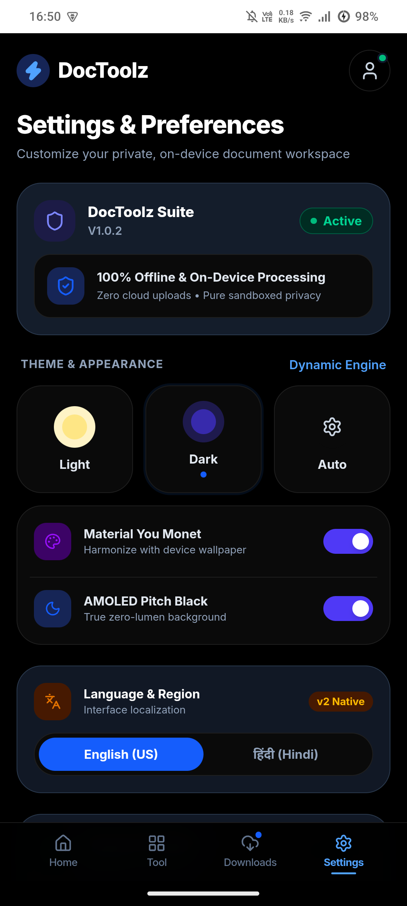

<div align="center">

# ⚡ DocToolz v1.0.2

### All-in-One Client-Side Image, Passport Photo & PDF Productivity Suite
**20+ Superfast Tools • 100% Private (Zero Server Uploads) • Bilingual (हिंदी / English) • Offline-Ready Android App**

[](https://chandan-itian.github.io/doctoolz/)
[-blueviolet?style=for-the-badge&logo=android&logoColor=white)](https://github.com/chandan-itian/doctoolz/releases/download/v1.0.2/DocToolz-v1.0.2.apk)
[](https://github.com/chandan-itian/doctoolz/releases/tag/v1.0.2)
[](LICENSE)
[](https://github.com/chandan-itian/doctoolz)
[](#-100-client-side-privacy-guarantee)

---

### [👉 🚀 Open DocToolz Live in Browser](https://chandan-itian.github.io/doctoolz/) 👈 &nbsp;|&nbsp; [📲 Download Android APK v1.0.2 (1,017 KB)](https://github.com/chandan-itian/doctoolz/releases/download/v1.0.2/DocToolz-v1.0.2.apk)

*Built for Indian government competitive exams (UPSC, SSC, IBPS, State PSCs, NTA/JEE), university admissions, passport/visa portals, and everyday digital document security.*

</div>

---

## 📸 DocToolz v1.0.2 Visual Showcase

### Light Mode vs. Dark Mode UI

<div align="center">
  <table>
    <tr>
      <td align="center" width="50%">
        <b>☀️ Light Mode (Adaptive Pastel UI)</b><br><br>
        
      </td>
      <td align="center" width="50%">
        <b>🌙 Dark Mode (Modern Deep Slate UI)</b><br><br>
        
      </td>
    </tr>
  </table>
</div>

---

### Key Feature Highlights in v1.0.2

<div align="center">
  <table>
    <tr>
      <td align="center" width="33%">
        <b>🖼️ Photo Compressor & Unit Converter</b><br>
        <i>Multi-unit (Pixel, MM, CM, Inch) at 300 DPI with Live Output Preview</i><br><br>
        
      </td>
      <td align="center" width="33%">
        <b>📥 Local Downloads Manager</b><br>
        <i>Offline storage, instant file preview modal, native sharing & PDF viewing</i><br><br>
        
      </td>
      <td align="center" width="33%">
        <b>⚙️ AMOLED Pitch Black & Cache Cleaner</b><br>
        <i>True zero-lumen OLED background & 1-tap sandbox cache clearing</i><br><br>
        
      </td>
    </tr>
  </table>
</div>

---

## 📑 Table of Contents

- [🌟 What's New in v1.0.2](#-whats-new-in-v102)
- [🛡️ 100% Client-Side Privacy Guarantee](#️-100-client-side-privacy-guarantee)
- [🧭 Modern UI & Sleek Bottom Navigation](#-modern-ui--sleek-bottom-navigation)
- [🛠️ The 20 Core Tools by Category](#️-the-20-core-tools-by-category)
  - [Category 1: Exam & Student Form Essentials](#-category-1-exam--student-form-essentials)
  - [Category 2: Advanced PDF Suite](#-category-2-advanced-pdf-suite)
  - [Category 3: Document Safety & Privacy](#-category-3-document-safety--privacy)
  - [Category 4: Image, Photo & Productivity Utilities](#-category-4-image-photo--productivity-utilities)
- [📱 Native Android APK v1.0.2](#-native-android-apk-v102)
- [💻 Tech Stack & Architecture](#-tech-stack--architecture)
- [🚀 Local Development Setup](#-local-development-setup)
- [🧪 Comprehensive QA & Verification Test Suite](#-comprehensive-qa--verification-test-suite)
- [📦 GitHub Pages Deployment](#-github-pages-deployment)
- [👤 Author & Credits](#-author--credits)
- [📄 License](#-license)

---

## 🌟 What's New in v1.0.2

1. **Card Renames & Visual Streamlining**:
   - `ExactKbResizer` ➔ **`Photo Compressor`**
   - `Admit Card Prep` ➔ **`Photo and Signature Merger`**
   - `Format Convert` ➔ **`PhotoToPdf`**
   - `Reorder Pages` ➔ **`Page Reorder Pdf`**

2. **Photo Compression Engine Overhaul**:
   - **Multi-Unit Dimension Converter**: Set dimensions in **`Pixel (px)`**, **`MM (mm)`**, **`CM (cm)`**, or **`Inch (in)`** with automatic real-time conversion at the 300 DPI high-clarity print standard.
   - **Upload Image & Demo**: Section title updated to `Upload Image` with a one-click `Try Demo img` feature.
   - **Live Output Photo Preview**: View real-time output image, exact calculated KB, format badge (`JPG`, `PNG`, `WEBP`), pixel dimensions, and 300 DPI verification badge.
   - **Native Sharing**: One-click sharing via Android's native share intent (`AndroidBridge.shareFile`) and Web Share API.

3. **Document Scanner with Dual Capture & 6 Filters**:
   - **Dual Triggers**: Open camera directly (`capture="environment"`) or browse local files.
   - **6 Document Filters**: `Magic Clean`, `Black & White`, `Grayscale`, `Vibrant Color`, `Warm Tone`, and `High Contrast`.
   - **Multi-Page Management**: Rotate pages 90°, delete unwanted pages, and compile into a multi-page PDF in one tap.

4. **Sleek 4-Tab Bottom Navigation & Downloads Manager**:
   - Compact modern 48px height (`h-12`) bar with 4 tabs: **`Home`**, **`Tool`**, **`Downloads`**, and **`Settings`**.
   - **Local Downloads Manager**: View all downloaded images and PDFs completely offline. Filter by `All Files`, `Images`, or `PDFs`. Open in full-screen preview modal, share directly, re-download, or delete.

5. **True AMOLED Zero-Lumen Pitch Black**:
   - Toggle **`AMOLED Pitch Black`** in Settings for pure `#000000` background and `#0a0a0a` cards for zero battery drain on OLED screens. Toggle off to return to standard slate theme.

6. **Storage & Sandbox Cache Cleaner**:
   - One-tap **`Clear`** button purges temporary buffers, `sessionStorage`, browser cache, and native WebView cache via `AndroidBridge.clearAppCache()`, immediately resetting the storage gauge to `0.0 MB`.

7. **Native Hardware Back Button Support**:
   - Pressing the physical Android back button smoothly dismisses modals, navigates from tools back to Home, and switches tabs without abruptly closing the app.

---

## 🛡️ 100% Client-Side Privacy Guarantee

| Security Dimension | Traditional Online Converters | DocToolz ⚡ |
|---|---|---|
| **Server Uploads** | ❌ Files sent to external third-party servers | ✅ **Zero server uploads (100% in-browser memory)** |
| **Privacy & Leak Risk** | ❌ Risk of identity and document leaks | ✅ **Zero telemetry, zero file retention** |
| **Network Speed** | ❌ Dependent on upload/download bandwidth | ✅ **Instant canvas processing (sub-second speeds)** |
| **Offline Capability** | ❌ Fails without active internet | ✅ **Works completely offline once loaded** |
| **Hosting Cost** | ❌ Expensive cloud storage & API costs | ✅ **₹0 Hosting (Hosted on GitHub Pages)** |

---

## 🧭 Modern UI & Sleek Bottom Navigation

1. **Category Filter Tabs**:
   - 🌟 **All Tools** (20 Tools)
   - 🖼️ **Photo & KB** (10 Tools)
   - 📄 **PDF Tools** (8 Tools)
   - 🎓 **Exam & Students** (8 Tools)
   - 🛡️ **Privacy & Safety** (5 Tools)
2. **Instant Search Bar**: Filter tools by keywords (e.g. *50KB, Passport, Age, Watermark, QR, Split*).
3. **Sleek 4-Tab Bottom Dock**:
   - 🏠 **Home**: Quick grid of all 20 tools with pastel cards and search.
   - 🧰 **Tool**: Direct access to the currently active tool.
   - 📥 **Downloads**: Built-in offline file manager for generated images and PDFs.
   - ⚙️ **Settings**: Themes, AMOLED mode, language toggle (Hindi/English), and sandbox cache cleaner.

---

## 🛠️ The 20 Core Tools by Category

### 🎓 Category 1: Exam & Student Form Essentials

| Tool Name | Key Capabilities | Technical Engine |
|---|---|---|
| **1. Photo Compressor** | Compress photo to exact target KB (e.g. 20KB, 50KB, 100KB) with custom resolution in Pixel, MM, CM, and Inch at 300 DPI with real-time output preview. | HTML5 Canvas + Adaptive Binary Search |
| **2. Exam Age & Cut-off Date Calculator** | Calculate exact age in years, months, days on official exam cut-off dates. Includes category age relaxation (OBC +3y, SC/ST +5y, PwD +10y) for UPSC, SSC, IBPS, NDA, RRB. | Date difference & relaxation engine |
| **3. CGPA to % & Marks Calculator** | Convert CBSE (×9.5), AICTE `((CGPA - 0.75) * 10)`, Mumbai Uni, or custom CGPA to percentage. Includes total marks to division and grade. | Math & Board Formula Registry |
| **4. Digital Signature Pad & Studio** | Draw digital signature with touch or mouse. Fine, medium, bold thickness, black/blue/red pen ink. Export crisp signatures with 100% transparent PNG or white card. | HTML5 Canvas Touch & Pen API |
| **5. Photo and Signature Merger** | Combine candidate photo and signature into a clean vertical composite card under custom target KB in JPG, PNG, or WebP format. | Canvas Multi-layer Composite |
| **6. Marksheet Cutoff Calculator** | Calculate aggregate percentages, subject totals, and cutoff margin analysis for competitive entrance exams. | Client-side Math Engine |

---

### 📄 Category 2: Advanced PDF Suite

| Tool Name | Key Capabilities | Technical Engine |
|---|---|---|
| **7. PDF Compress** | Shrink marksheets, caste certificates, and documents under strict upload limits (<100KB, <200KB, <500KB) directly in your browser. | `pdfjs-dist` + Canvas + `pdf-lib` |
| **8. Merge & Split PDF** | Combine multiple PDF files into a single document or extract selected page ranges into a new lightweight PDF. | `pdf-lib` stream merging & slicing |
| **9. Page Reorder Pdf** | Visual drag-and-drop PDF page reordering, 90° page rotation, and selective deletion before saving. | `pdfjs-dist` + `pdf-lib` |
| **10. PDF Protect & Password** | Secure sensitive documents and marksheets with military-grade 128-bit AES password encryption directly in browser. | `@pdfsmaller/pdf-encrypt` AES-256/128 |
| **11. PhotoToPdf Convert** | Convert single or multiple images (JPG, PNG, WebP) into a compact PDF with orientation and margin controls. | `pdf-lib` pure JS engine |
| **12. Document Scanner** | Capture documents via direct camera shutter or gallery files. Apply Magic Clean, B&W, Grayscale, Vibrant, Warm, or High Contrast filters and save to PDF. | HTML5 MediaDevices / Camera API + Canvas Filters |

---

### 🛡️ Category 3: Document Safety & Privacy

| Tool Name | Key Capabilities | Technical Engine |
|---|---|---|
| **13. Custom Watermark Stamper** | Stamp custom diagonal security watermarks (e.g. *"Only for UPSC 2026"*, *"Self Attested Copy"*) with adjustable opacity across Aadhaar or PAN. | Canvas 2D Text Stamping with Opacity |
| **14. Document Redactor & Masker** | Blackout box, pixelate mosaic, or blur private information (Aadhaar numbers, phone, signatures, QR codes) before sharing documents online. | Canvas Pixel Manipulation & Box Blur |
| **15. Metadata Stripper** | Strip EXIF metadata, GPS geotags, camera serial numbers, and author tags from photos before uploading to public portals. | Pure JS Binary EXIF Header Parser |
| **16. PDF to Word & OCR** | Extract printed text from images and scanned document pages in Hindi and English without sending data to external servers. | `tesseract.js` WebAssembly Worker |

---

### 🖼️ Category 4: Image, Photo & Productivity Utilities

| Tool Name | Key Capabilities | Technical Engine |
|---|---|---|
| **17. QR & Barcode Studio** | Generate custom QR codes for UPI payments, Wi-Fi, URLs, and vCards. Scan QR codes from image files or device camera. | `qrcode` + `jsQR` (Pure JS) |
| **18. Background Remover** | Passport portrait background replacement (white, blue, custom) for official exams and visa applications. | Canvas Color Segmentation & Flood Fill |
| **19. ID Card Maker** | Generate candidate admit cards and identity cards with candidate photo, signature, and barcode. | Canvas Template Layout Engine |
| **20. Batch Process** | Bulk multi-file image resizer and compressor to process dozens of images simultaneously. | Asynchronous Batch Worker |

---

## 📱 Native Android APK v1.0.2

DocToolz is available as a native, lightweight, and hardware-accelerated Android APK:

- **📦 Ultra-Compact Size**: **1,017 KB** (~1.0 MB)
- **⚡ 100% Offline**: Operates completely on-device without internet access.
- **📥 Built-in Downloads Manager**: Access compressed photos and scanned PDFs directly within the app.
- **💾 Direct Android Downloads**: Saves files into `Downloads/DocToolz` on your device.
- **🔗 Native Sharing**: Shares generated documents directly to WhatsApp, Drive, Gmail, or Telegram.
- **🖤 AMOLED Pitch Black**: True `#000000` background for maximum battery efficiency.
- **📱 Android Compatibility**: Supports Android 7.0 (API 24) through Android 15 (API 35).

[📥 Download DocToolz v1.0.2 APK (1,017 KB)](https://github.com/chandan-itian/doctoolz/releases/download/v1.0.2/DocToolz-v1.0.2.apk) • [🏷️ View v1.0.2 Release Notes](https://github.com/chandan-itian/doctoolz/releases/tag/v1.0.2)

---

## 💻 Tech Stack & Architecture

- **Core Framework**: React 19 + TypeScript
- **Bundler & Tooling**: Vite 8 + Rolldown
- **Styling**: Tailwind CSS v4 with custom AMOLED & Dark mode variants
- **Iconography**: Lucide React
- **PDF Engine**: `pdf-lib`, `pdfjs-dist`, `@pdfsmaller/pdf-encrypt`, `@pdfsmaller/pdf-decrypt`
- **Computer Vision & OCR**: `tesseract.js`, `jsqr`, `qrcode`
- **Native Android Wrapper**: Lightweight WebView wrapper with `@JavascriptInterface` bridge for file saving, sharing, and cache clearing.

---

## 🚀 Local Development Setup

```bash
# 1. Clone the repository
git clone https://github.com/chandan-itian/doctoolz.git
cd doctoolz

# 2. Install dependencies
npm install

# 3. Start development server
npm run dev

# 4. Build production static bundle
npm run build
```

Open `http://localhost:5173/doctoolz/` in your browser.

---

## 🧪 Comprehensive QA & Verification Test Suite

DocToolz includes automated tests to verify client-side processing:

```bash
node scripts/test-all-tools.mjs
```

**Verification Results:**
- ✅ `TEST 1: JPEG File Size Increaser to 50KB` (SOI `0xFFD8`, APP0 `0xFFE0`, COM padding)
- ✅ `TEST 2: PNG File Size Increaser to 40KB` (PNG magic byte, tEXt chunk, valid CRC32)
- ✅ `TEST 3: Cut-off Date Age Calculator & Eligibility` (Years, months, days, OBC +3y relaxation)
- ✅ `TEST 4: CGPA & Marks Percentage Calculations` (CBSE 8.4 = 79.8%, AICTE, Marks to Division)
- ✅ `TEST 5: PDF Merger (Combine Multiple PDFs)` (Combines multiple documents into 1 PDF)
- ✅ `TEST 6: PDF Splitter (Extract Specific Pages)` (Extracts chosen page indices)
- ✅ `TEST 7: PDF Password Encryption (128-bit AES)` (Protects & unlocks PDF with password)
- ✅ `TEST 8: QR Generator & UPI / Wi-Fi Helpers` (UPI pay format, Wi-Fi string, Data URL)

---

## 📦 GitHub Pages Deployment

The project is deployed to GitHub Pages via the `gh-pages` branch with `.nojekyll` enabled:

```bash
# Build production bundle and deploy to gh-pages branch
npm run deploy
```

- **Live URL**: [https://chandan-itian.github.io/doctoolz/](https://chandan-itian.github.io/doctoolz/)

---

## 👤 Author & Credits

- **Creator & Developer**: **Chandan Raj**
- **GitHub**: [@chandan-itian](https://github.com/chandan-itian)
- **Live Project**: [DocToolz on GitHub Pages](https://chandan-itian.github.io/doctoolz/)

<div align="center">
  <sub>Made with ❤️ by <b>Chandan Raj</b></sub>
</div>

---

## 📄 License

This project is licensed under the **MIT License** — free for personal, educational, and commercial use.
